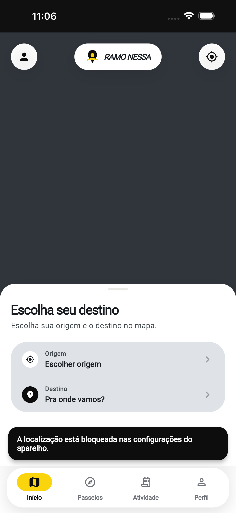
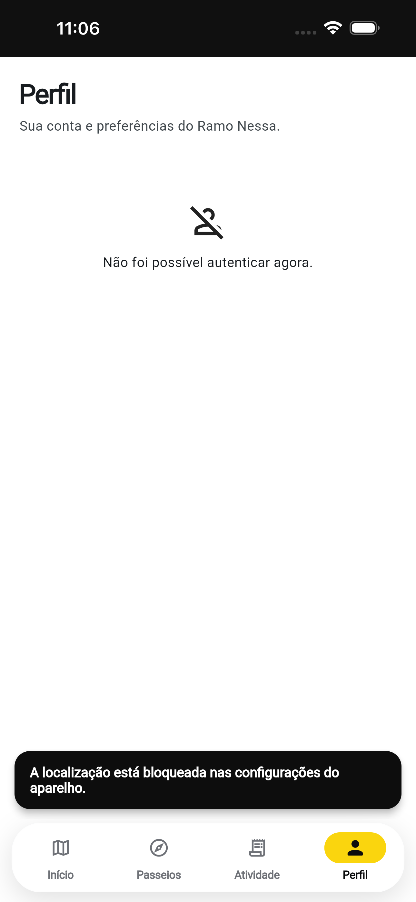

# Primeiro toque da PWA iOS: correção candidata verificada

Fonte: `a8a766a62fb637c687bc7d079ebb247b864f82dd`.
Validação: [Actions 38978710786](https://github.com/iansilva23/ramo-nessa/actions/runs/38978710786).
Reprodução anterior: [auditoria nativa](https://github.com/iansilva23/ramo-nessa/blob/7df5aeab9d574eef5e488e0061ee7575b3d5c070/docs/audits/20261016-ios-pwa/README.md).

O app foi instalado pela interface do Safari em um simulador iPhone 15 Pro Max/iOS 26.5 e aberto pelo ícone da tela de início, no processo `com.apple.webapp`. O teste aguardou o controle aparecer em capturas de tela; não ativou a semântica web e não tocou antes em outro lugar.

O primeiro toque no centro pintado do avatar abriu a tela de Perfil. As capturas foram conferidas visualmente, além da comparação automática de imagens. A mensagem de autenticação nessa tela pertence à resposta limitada da API simulada; os testes de login/cookie/logout são independentes e passaram em Chromium e WebKit.

| Medição no primeiro toque instalado | Reprodução anterior | Candidato |
| --- | ---: | ---: |
| `scrollY` | 59 | 0 |
| `visualViewport.offsetTop` | 59 | 0 |
| `flutter-view.getBoundingClientRect().y` | -59 | 0 |
| Escala | 1 | 1 |
| Semântica web ativada antes do toque | não | não |
| Resultado visível | início permanece | Perfil abre |

O ponto pintado na tela foi `(44, 102.83)` pontos. Com a barra de status opaca, o conteúdo fica abaixo da área de status: o evento chegou com `clientX=44`, `clientY=44`, e a raiz Flutter em `(0,0)`. Não existe compensação fixa de 59 pontos no código.

## Escopo e verificações

- Ambos os HTML web usam a barra de status preta opaca.
- Controles e painéis pintados sobre o mapa usam `RamoWebMapOverlay`; fora do web, o widget retorna o filho original.
- O interceptor não envolve o mapa, o `Stack` inteiro nem espaços vazios de alinhamento.
- Quatro cenários de WebKit passaram: mapa passivo/capturando eventos, com semântica fria/ativada. O cenário frio confirma que a área livre ainda pertence ao mapa.
- A mesma fonte de aplicação passou em análise e testes: 147 testes do passageiro, 97 do motorista, 18 testes compartilhados e regressões de tempo real/login/cookies/logout.
- Os bundles de revisão compilados em `036f8ec110c0250fd99fb7a4ea91334e18726bdc` foram reutilizados no teste nativo somente após conferir que as mudanças posteriores se limitavam ao workflow, ao teste Swift e ao checkpoint de revisão. Os pacotes configurados são recompilados no commit final.

O mapa e os provedores foram simulados e não houve chamadas a produção. Esse resultado cobre a reprodução do primeiro toque e a interceptação dos controles; não substitui o aceite no aparelho físico, os gestos com o Google Maps real ou testes de outras versões do iOS. Nenhuma atualização da VPS é executada por esse workflow.

Ao aplicar a atualização na homologação, remover o ícone antigo e adicionar novamente pelo Safari para atualizar os metadados de instalação. Não apagar dados gerais do Safari. Pode ser necessário entrar novamente na conta.
